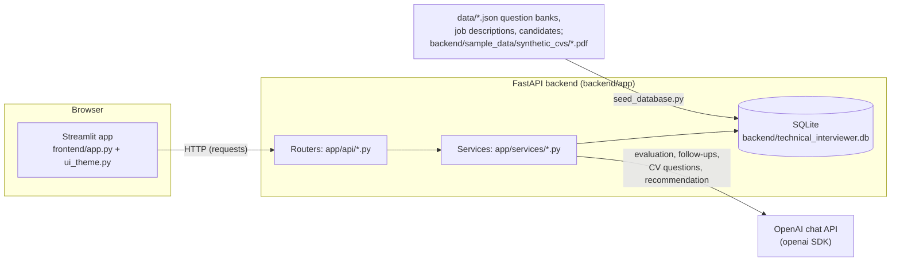

# Architecture

Paths are relative to the repository root. Function and route names were read from the source.

## Components

- **Frontend:** `frontend/app.py` is a single Streamlit script. `main()` routes by `st.session_state.page` through the `PAGES` table
  (landing, candidate, interview, complete, results, interviewer login/dashboard/schedule/review/progress). Every backend call is a small
  `requests` helper at the top of the file.
- **Backend:** `backend/app/main.py` builds the FastAPI app, enables CORS for `localhost:8501/5173/3000`, calls `init_db()` on startup and
  includes one router per module in `backend/app/api/`.
- **Database:** SQLAlchemy models in `backend/app/db/models.py`; the engine and the additive migrations in `backend/app/db/database.py`
  (`DATABASE_URL` is hard-coded to `sqlite:///technical_interviewer.db`, relative to the directory the backend is started from).
- **LLM:** `openai==1.3.9` client calls inside `services/llm_evaluation.py`, `follow_up_generator.py` and `cv_processor.py`; every call is
  logged by `services/llm_usage_logger.py`.

## Interview lifecycle (stored statuses: `not_started`, `in_progress`, `completed`, `abandoned`)

```mermaid
stateDiagram-v2
    [*] --> not_started: POST /api/interviews (schedule)
    not_started --> in_progress: POST /start (needs consent; CV modes need a CV)
    in_progress --> completed: POST /complete (all main questions answered and evaluated)
    in_progress --> abandoned: POST /abandon (candidate confirmed)
    completed --> [*]
    abandoned --> [*]
```

"Scheduled" and "Reviewed" are derived display labels (`services/interview_status.py: compute_display_status`): `not_started` is shown as Scheduled, and
`completed` with a row in `human_reviews` as Reviewed.

## Flow 1: scheduling and CV association
1. Interviewer page `show_interviewer_schedule()` (frontend) chooses candidate, role and mode. For CV modes it shows the candidate's saved CV or requires an upload.
2. `POST /api/interviews` (`api/interviews.py: create_interview`) validates candidate, job and mode. If a CV mode has no CV in the request it copies
   `candidates.cv_text` into `interviews.cv_text` (a snapshot, so later changes to the candidate's saved CV never alter the interview).
3. A supplied CV is scanned by `services/security_checks.py: record_security_check` and the result stored in `content_security_checks`.
4. Replacement uploads: `POST /api/interviews/{id}/upload-cv` (interview only; optional `save_to_candidate=true`) and `POST /api/candidates/{id}/cv`
   (the candidate's saved CV). Both use `services/candidate_cv.py: read_cv_pdf`, which calls `cv_processor.extract_text_from_pdf` (pypdf) and `validate_cv_text`
   (non-empty, at least 100 characters). The PDF itself is not stored, only the extracted text.
5. Seeding: `backend/seed_database.py: seed_into` loads the JSON data and calls `candidate_cv.attach_synthetic_cvs`, which links each sample PDF to its
   candidate through `sample_data/synthetic_cvs/manifest.json` (matched by e-mail; refused if the name printed in the PDF differs).

## Flow 2: consent and start
`GET /api/data-handling` returns the notice facts (`services/data_policy.py: get_data_handling_policy`). The candidate screen
(`_render_consent_notice`, `_render_candidate_interview_card`) shows an unchecked box; `POST /api/interviews/{id}/consent` stores
`consent_status`, `consent_recorded_at`, `consent_notice_version`. `require_consent()` (`services/data_policy.py`) is called in `start`,
`submit_answer`, `next-question`, evaluate and `complete`, so the backend does not depend on the UI. `POST /start` then assigns the first question.

## Flow 3: question selection and follow-ups
- Constants in `services/question_adapter.py`: `MAIN_QUESTION_COUNT = 5`, `MAX_FOLLOW_UPS = 3`, `CV_MODES = ("cv_driven", "hybrid")`.
- At `/start`, CV-Driven generates CV questions (`cv_processor.generate_cv_driven_questions`, stored with category `cv_generated`); Hybrid generates a mix
  (`generate_hybrid_questions`, category `hybrid_generated`); Question Bank generates nothing.
- Main questions come from `services/question_selector.py: select_question_bank_adaptive`: role filter, pool per mode (`_pools_for_mode`; Hybrid alternates CV and
  bank questions), nearest difficulty (`_choose`), preferring an unused category. A question of another role is never selected.
- After each answer is evaluated, `POST /next-question` (`interviews.py: get_next_question`, under `keyed_lock("next-question", id)`) calls
  `question_adapter.decide_follow_up`: a follow-up is wanted when the evaluation says vague, incomplete or incorrect, when it contradicts the CV (CV modes only), or when
  the score is at most 3; it is refused when 3 follow-ups already exist for that main question. The text is written by
  `follow_up_generator.generate_follow_up_question` and stored as a question with category `follow_up`. Otherwise `target_main_difficulty` picks the next
  main question's difficulty from earlier main-question scores (follow-ups do not advance the main count).
- Position and numbering are derived from stored rows by `services/interview_session.py` (`load_steps_for_interview`, `number_steps`, `next_action`);
  `GET /session` exposes this so an interrupted client resumes exactly (`frontend/app.py: _resume_interview`).

## Flow 4: evaluation and recommendation
1. `POST /api/interviews/{id}/questions/{iq}/answer` (`submit_answer`, under `keyed_lock("interview-state", id)`) stores one answer (unique index
   `uq_answers_interview_question`; a repeat returns the existing answer) and records a prompt-injection check for it.
2. `POST /api/answers/{id}/evaluate` (`api/answers.py: evaluate_answer_endpoint`, `keyed_lock("evaluate", id)`) calls
   `services/llm_evaluation.py: evaluate_answer`. The system prompt is `EVALUATION_SYSTEM_PROMPT`; candidate text goes only in the user message as delimited
   untrusted blocks (`prompt_safety.build_messages`, `untrusted_block`). The reply must be JSON with four dimension scores (1-5), justification and quote per
   dimension, follow-up decision and `contradicts_cv`; `validate_evaluation_output` rejects anything else, `extract_quote_from_answer` marks a quote that is not in
   the answer as paraphrased, and `calculate_legacy_score` derives the 0-10 score in code. One evaluation per answer (`uq_evaluations_answer`).
3. `POST /api/interviews/{id}/complete` (`interviews.py: complete_interview`) requires every main question answered and evaluated, averages the answer scores, builds
   a summary and calls `llm_evaluation.generate_recommendation` (`RECOMMENDATION_SYSTEM_PROMPT`: Strong Hire / Hire / Hold / No Hire, confidence High/Medium/Low, reason),
   then stores a `recommendations` row and sets `status = completed`.

## Flow 5: security checks (separate from scoring)
`services/injection_detector.py: detect_prompt_injection` (regular expressions, Unicode normalisation) returns clean or suspected with categories and a short excerpt.
`security_checks.record_security_check` upserts one row per interview and source (CV, or one answer); a detector exception is stored as `failed`, never as clean.
The result is never passed to the evaluator and never changes a score. Reports show it to the interviewer only.

## Flow 6: human review
`GET /api/interviews/{id}/review-data` feeds the review page (`frontend/app.py: show_interviewer_review`, `_render_human_review`).
`POST /human-review` (accept) and `POST /human-review/override` (needs a reason) in `api/human_review.py` insert one `human_reviews` row per interview
(unique index), copying the AI recommendation, confidence and reasoning at decision time. The AI recommendation row is never modified. The reviewer identity is the constant
`demo-interviewer` / `Demo Interviewer` because the application has no user accounts. Abandoned interviews cannot be reviewed.

## Flow 7: abandonment
`POST /api/interviews/{id}/abandon` (`interviews.py: abandon_interview`) takes `keyed_lock("next-question")` and `keyed_lock("interview-state")` and performs one conditional
UPDATE (`in_progress` to `abandoned`, sets `abandoned_at`); repeats are idempotent. Answer, next-question, evaluate, complete and consent then return errors.

## Flow 8: reports
`GET /api/interviews/{id}/report` (`api/reports.py`) calls `services/report_builder.py: build_feedback_report` (no LLM call): transcript, verified quotes (`verified_quote`),
strengths and gaps from stored scores, next-round areas, security summary, human review, consent. Completed interviews get the full report; abandoned ones a partial report
(no overall score or human review). `report_export.py` renders the same blocks to Markdown (`render_markdown`) and PDF (`render_pdf`, fpdf2) for `/report.md` and `/report.pdf`.

## Flow 9: LLM usage logging
Each OpenAI call writes one `llm_usage_logs` row through `services/llm_usage_logger.py: log_usage` (operation, model, provider-returned token counts, latency, status, error class).
Cost is computed at read time (`services/llm_pricing.py: estimate_cost_usd`, `services/usage_aggregator.py`) and shown at `GET /api/interviews/{id}/usage` and `GET /api/usage`.

## Error handling and dependencies
- The evaluator, follow-up generator and question generator raise on provider errors; the API returns HTTP 500 with a generic message (the underlying exception is only in the server log).
  Malformed model output is HTTP 502 and is never accepted.
- The frontend saves, then evaluates, then asks for the next question; each step is safe to repeat, so a failed step is retried from `GET /session`.
- Duplicate-work protection uses in-process locks (`services/locks.py`) plus the database unique indexes, which are the real guard.
- External dependencies: the OpenAI API (all AI features) and the local SQLite file. Without a valid key or credit, evaluation, CV question generation and recommendations fail.
